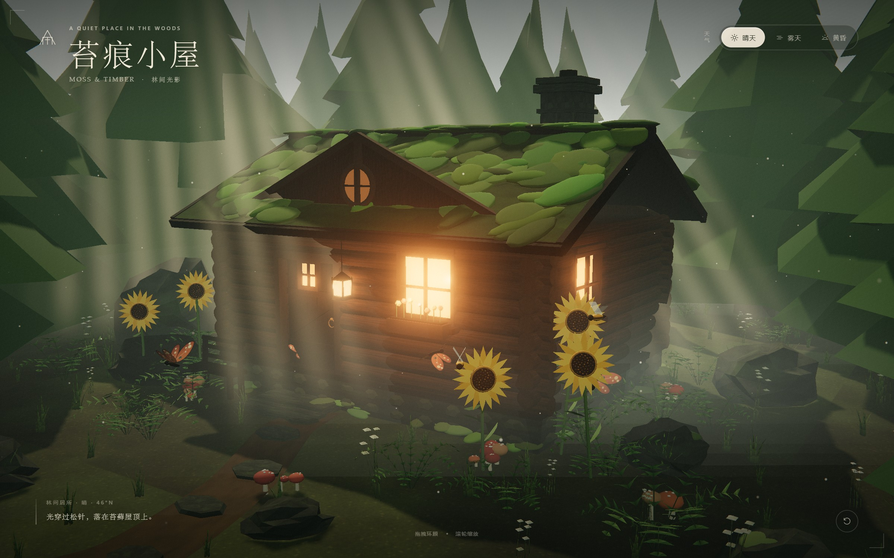
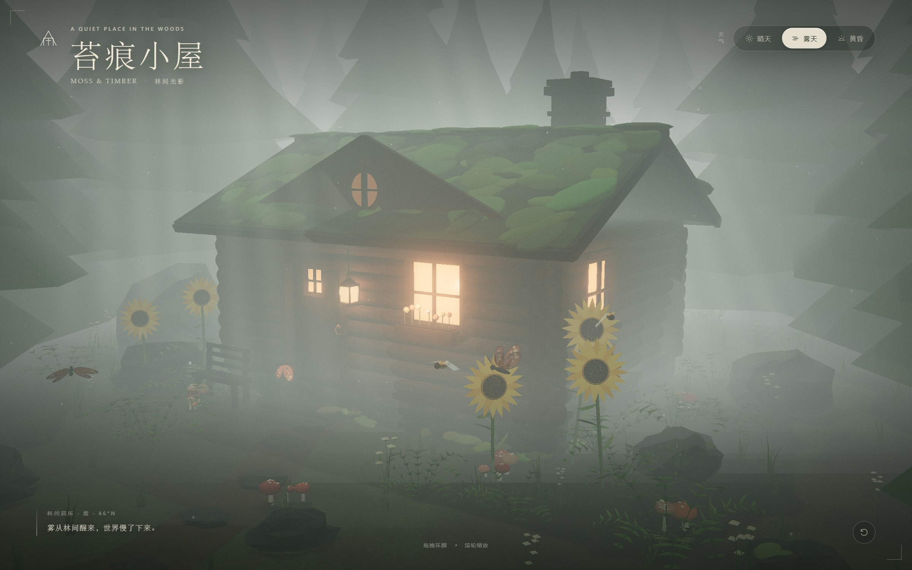
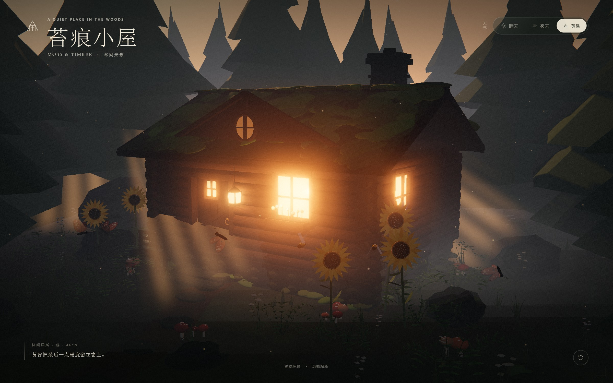
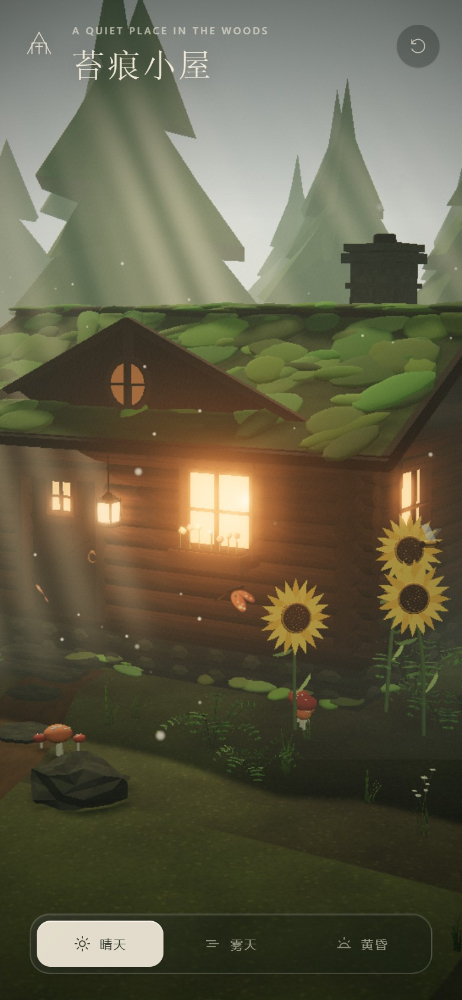
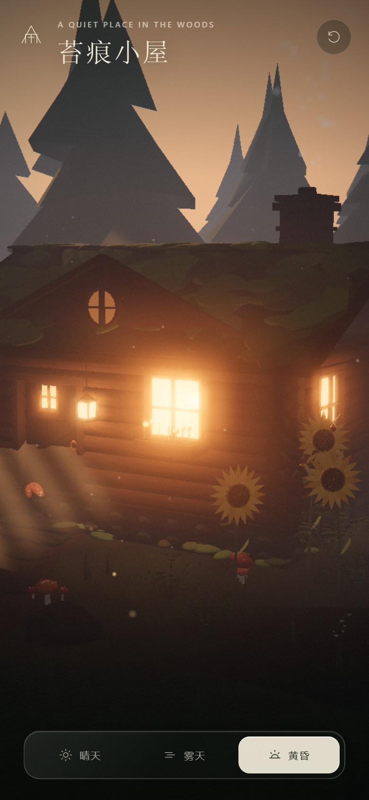

# 苔痕小屋 · Moss & Timber

一个用 **Three.js** 构建的可交互 3D 森林小屋。所有模型、材质与纹理均在浏览器中程序化生成，没有外部模型或图片依赖。阳光穿过松林形成柔和的丁达尔光束，原木、石基与苔藓屋顶藏在薄雾里，蝴蝶和蜜蜂在不远处停留。

**在线预览：<https://koibunny.github.io/moss-and-timber/>**



| 雾天 | 黄昏 |
| --- | --- |
|  |  |

| 移动端 · 晴天 | 移动端 · 黄昏 |
| --- | --- |
|  |  |

## 快速开始

环境要求：

- Node.js **20.19+**（或 22.12+）
- 支持 WebGL 2 的现代浏览器（Chrome / Edge / Safari / Firefox）

```bash
# 1. 安装依赖
npm install

# 2. 启动开发服务器
npm run dev
# 打开 http://localhost:5173

# 3. 生产构建
npm run build

# 4. 本地预览生产版本
npm run preview
# 打开 http://localhost:4173

# 5. 轻量静态预览（仅使用 Node 内置模块，服务 dist/）
npm run serve
# 打开 http://127.0.0.1:4173
```

Windows 下也可以直接双击 **`启动预览.cmd`**：脚本会在首次运行时自动安装依赖并构建，然后启动本地服务并打开浏览器。

构建后的静态文件位于 `dist/`。项目使用相对资源路径（`base: './'`），可以直接部署到 Netlify、Vercel、GitHub Pages 或任意静态文件服务器。

> 不要直接双击打开 `index.html`：ES Modules 需要通过 HTTP 服务器加载。

## 交互

| 操作 | 说明 |
| --- | --- |
| 鼠标拖拽 / 单指拖动 | 环绕小屋旋转视角 |
| 滚轮 / 双指捏合 | 拉近、拉远 |
| `1` / `2` / `3` | 切换晴天 / 雾天 / 黄昏 |
| `R` | 重置视角 |
| 右下角 ↺ 按钮 | 平滑回到初始构图 |

天气切换会平滑过渡约 2.5–2.9 秒。相机空闲约 19 秒后会开始非常缓慢的自动环绕，移动或缩放后立即停止。

## 场景内容

- **原木小屋**：逐根堆叠的圆木墙体、交错的原木端头、石砌地基、木瓦与苔藓屋顶、阁楼圆窗、门顶小窗、门上提灯、暖光窗格、窗下花箱、长椅、踏步石与烟囱轻烟。
- **森林**：程序化松树（多个随机树型 + InstancedMesh）、蕨类、草丛、杂草与穗状野花、蘑菇群、风化岩石与倒木。
- **花朵**：多株向日葵，程序化花瓣与花心种子，带轻微风摆。
- **生物**：四只环飞的蝴蝶与围绕花盘悬停的蜜蜂，均为逐帧动画。
- **光影**：方向光阴影、指数雾、天空渐变与太阳光晕、程序化云带、黄昏星点、向阳倾斜的体积光束、地面雾团、空气尘埃、黄昏萤火。
- **天气**：晴天 / 雾天 / 黄昏三套完整光照预设，平滑插值太阳方向、天空颜色、雾密度、环境光、窗口亮度、泛光强度与电影调色。
- **画面**：ACES Filmic 色调映射、UnrealBloom 泛光、暗角、细颗粒、轻微色差与纸张式 UI。

## 实现要点

### 光束与体积感

体积光由一组面向相机、沿太阳方向倾斜的加法混合四边形构成。每帧围绕光束轴做 billboard 旋转，片元着色器用边缘衰减、纵向衰减、流动噪声与条纹叠加得到柔和的丁达尔光束；再配合地面雾 sprite、尘埃粒子和泛光，形成空气感。

### 程序化资产

- 木纹、树皮、石材、苔藓、土路、蝴蝶翅膀、蜜蜂条纹均由 Canvas 2D 生成，最终成为 `CanvasTexture`。
- 松树、蕨类、草叶、向日葵、蘑菇、岩石与木屋构件都由基础几何体组合、顶点扰动或合并生成。
- 大量静态小物件通过 `mergeGeometries` 合并；松树、蕨类、草和杂草使用 `InstancedMesh`，显著减少 draw call。

### 移动端

- 通过 `(pointer: coarse)` 与视口宽度选择移动端质量档。
- 像素比上限：桌面 `1.75`，移动端 `1.4`。
- 移动端阴影贴图降为 `1024 × 1024`，松树、草、蕨类、薄雾和粒子数量同步减少。
- 控制器开启阻尼，限制俯仰角，避免穿地；窗口尺寸变化时自动同步渲染尺寸与相机投影。

### 氛围与调色

`src/world/atmosphere.js` 中的 `PRESETS` 定义了三套天气的完整参数。每一套都会同时影响天空 shader、平行光、半球光、雾、太阳方向、体积光束、尘埃、萤火、窗户亮度、曝光、泛光和后期色温，因此切换时不是简单换背景，而是整套光场一起过渡。

`src/world/postprocessing.js` 在色调映射之后叠加暗角、轻微色差、胶片颗粒和暖调分离，让画面更接近静帧电影。

## 工程结构

```text
.
├── index.html                  # 页面骨架、UI、加载动画
├── vite.config.js
├── package.json
├── docs/                       # 预览截图
└── src/
    ├── main.js                 # 渲染器、相机、控制器、加载流程、天气 UI
    ├── style.css               # 电影感界面与响应式布局
    ├── core/
    │   ├── rng.js              # 固定种子随机数与噪声
    │   ├── textures.js         # 程序化 Canvas 纹理
    │   ├── geometry.js         # 几何合并 / 变换 / 顶点色工具
    │   └── materials.js        # 风摆材质与阴影工具
    └── world/
        ├── terrain.js          # 地形、土路、踏步石
        ├── cabin.js            # 原木小屋全部构件、窗光、烟囱烟雾
        ├── vegetation.js       # 松树、蕨类、草、蘑菇、岩石、向日葵
        ├── creatures.js        # 蝴蝶与蜜蜂
        ├── atmosphere.js       # 天空、光照、雾、体积光束、粒子、天气预设
        └── postprocessing.js   # Bloom + 电影调色
```

## 可调参数

- **天气配色 / 光照 / 雾 / 光束强度**：`src/world/atmosphere.js` → `PRESETS`
- **初始相机与相机限制**：`src/main.js` → `getBaseCameraPosition()`、`controls.minDistance` / `maxDistance`
- **小屋尺寸和结构**：`src/world/cabin.js` 顶部常量（`WIDTH`、`DEPTH`、`RIDGE_Y` 等）
- **画质与物体数量**：`src/world/vegetation.js` 中的 `quality === 'mobile'` 分支
- **后期强度**：`src/world/postprocessing.js` 与 `PRESETS` 中的 `bloom`、`warmth`、`grain`

## 性能参考

在 AMD Radeon 集成显卡、Chrome headless（ANGLE / D3D11）下：

- 桌面 1440×900：约 60 FPS
- 移动端仿真 390×844 @ DPR 1.4（实际渲染 546×1181）：约 60 FPS

场景约 14.8 万三角形。不同设备的实际表现会受分辨率、GPU 和浏览器影响；如需进一步提速，可以降低移动端像素比、减少 `count` 或关闭 Bloom。

## 兼容性

- Three.js `0.180.0`
- Vite `8.3.5`
- 需要 WebGL 2；不支持 WebGL 的旧设备会停留在加载页
- 支持 `prefers-reduced-motion`：会跳过开场推镜并关闭自动环绕

---

所有画面与纹理均由代码生成。愿你在这里停留一会儿。
